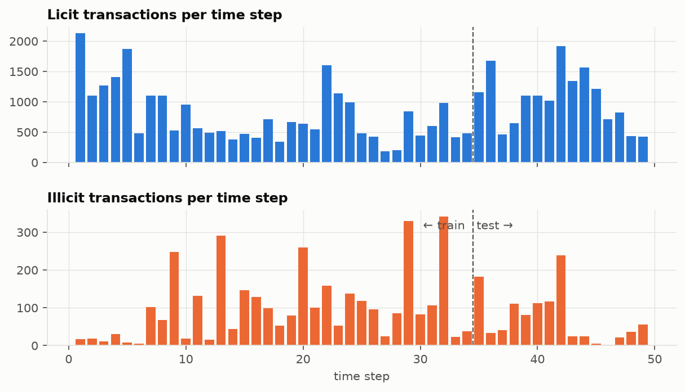
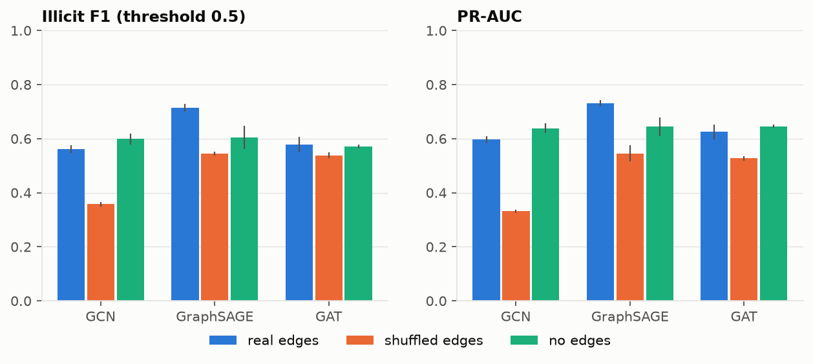
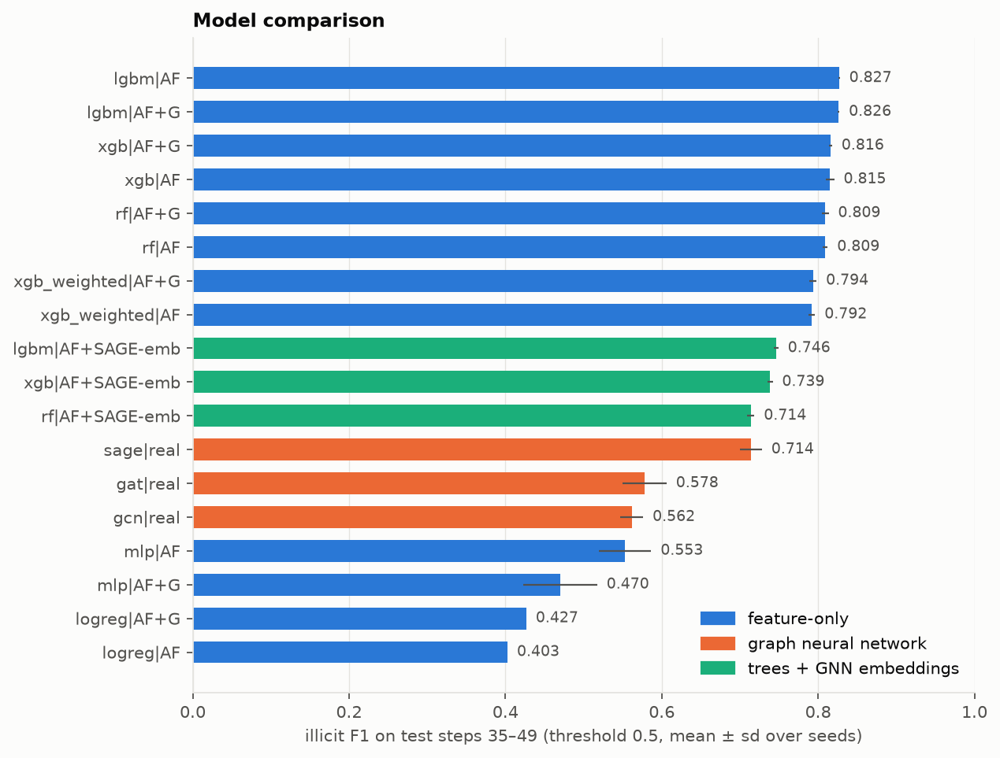
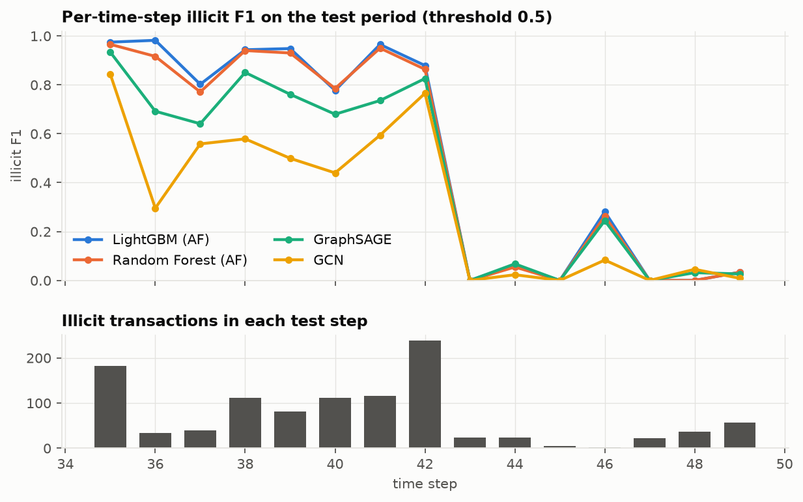
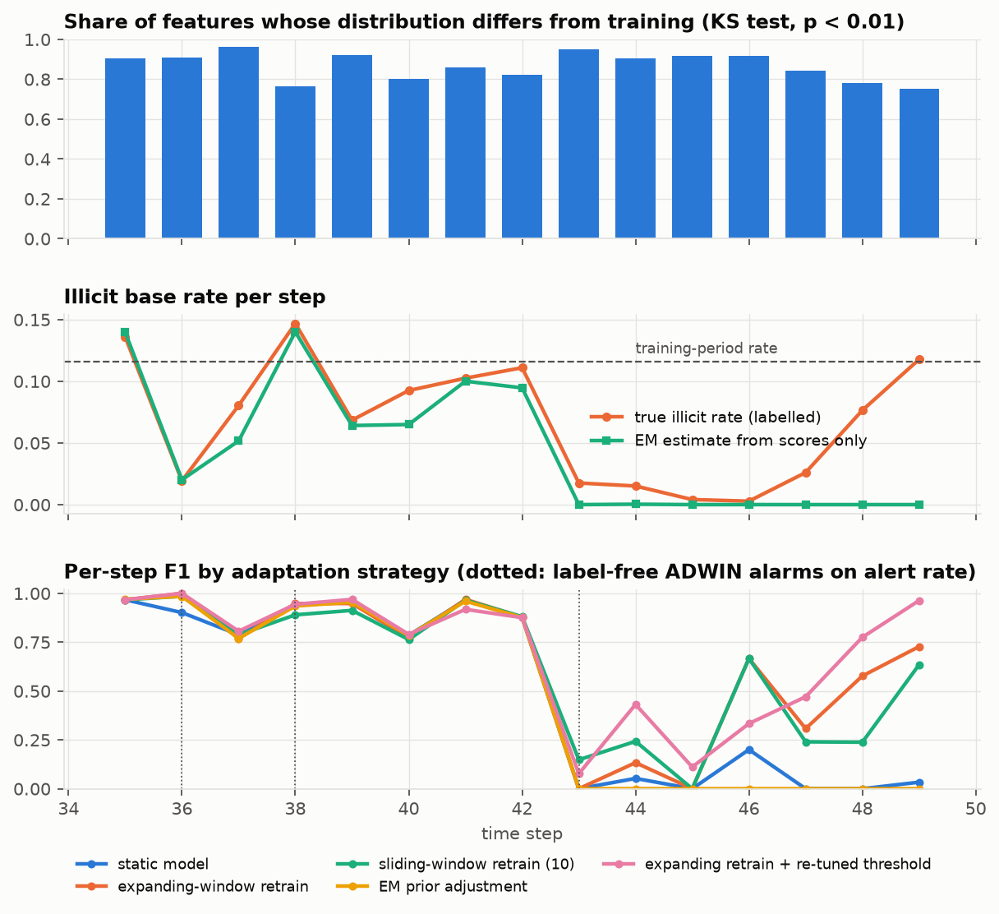
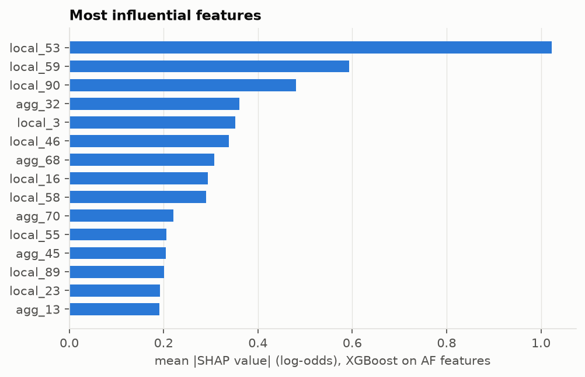

# ChainSleuth: full results

Auto-generated by `python -m chainsleuth.report` from `reports/results/*.json`. Test set = labelled transactions in time steps 35–49; models train on steps 1–34. *F1 @0.5* uses the default decision threshold; *F1 (val thr.)* uses the threshold that maximised F1 on validation steps 30–34 (model refit on 1–34 afterwards).

## Dataset

- 203,769 transactions, 234,355 directed edges, 166 features, 49 time steps
- labels: 4,545 illicit / 42,019 licit / 157,205 unknown
- train (1–34): 3,462 illicit, 26,432 licit; test (35–49): 1,083 illicit, 15,587 licit
- edges crossing time steps: **0**

## Feature-only models

LF = 93 local features, AF = all 165, AF+G = AF + 10 graph-mining features.

| Model | Features / edges | F1 @0.5 | F1 (val thr.) | Precision | Recall | PR-AUC | MCC | Seeds |
|---|---|---|---|---|---|---|---|---|
| lgbm | AF | 0.827 ± 0.001 | 0.822 ± 0.004 | 0.940 | 0.730 | 0.806 | 0.819 | 5 |
| lgbm | AF+G | 0.826 ± 0.001 | 0.816 ± 0.007 | 0.928 | 0.729 | 0.806 | 0.812 | 5 |
| xgb | AF+G | 0.816 ± 0.002 | 0.711 ± 0.011 | 0.679 | 0.746 | 0.804 | 0.691 | 5 |
| xgb | AF | 0.815 ± 0.005 | 0.717 ± 0.019 | 0.692 | 0.744 | 0.803 | 0.697 | 5 |
| rf | AF+G | 0.809 ± 0.004 | 0.761 ± 0.056 | 0.806 | 0.730 | 0.783 | 0.749 | 5 |
| rf | AF | 0.809 ± 0.003 | 0.698 ± 0.072 | 0.679 | 0.737 | 0.782 | 0.681 | 5 |
| xgb_weighted | AF+G | 0.794 ± 0.004 | 0.764 ± 0.019 | 0.791 | 0.740 | 0.803 | 0.749 | 5 |
| xgb_weighted | AF | 0.792 ± 0.004 | 0.784 ± 0.012 | 0.838 | 0.737 | 0.801 | 0.772 | 5 |
| lgbm | LF | 0.776 ± 0.003 | 0.757 ± 0.015 | 0.805 | 0.716 | 0.788 | 0.743 | 5 |
| xgb | LF | 0.771 ± 0.004 | 0.764 ± 0.011 | 0.830 | 0.708 | 0.786 | 0.751 | 5 |
| rf | LF | 0.768 ± 0.004 | 0.730 ± 0.032 | 0.742 | 0.724 | 0.769 | 0.713 | 5 |
| xgb_weighted | LF | 0.733 ± 0.004 | 0.758 ± 0.019 | 0.823 | 0.708 | 0.787 | 0.747 | 5 |
| mlp | LF | 0.669 ± 0.044 | 0.644 ± 0.064 | 0.591 | 0.726 | 0.596 | 0.624 | 5 |
| mlp | AF | 0.553 ± 0.033 | 0.582 ± 0.015 | 0.593 | 0.573 | 0.531 | 0.554 | 5 |
| logreg | LF | 0.494 ± 0.000 | 0.536 ± 0.000 | 0.435 | 0.698 | 0.277 | 0.513 | 1 |
| mlp | AF+G | 0.470 ± 0.047 | 0.510 ± 0.036 | 0.551 | 0.517 | 0.452 | 0.489 | 5 |
| logreg | AF+G | 0.427 ± 0.000 | 0.463 ± 0.000 | 0.484 | 0.443 | 0.356 | 0.428 | 1 |
| logreg | AF | 0.403 ± 0.000 | 0.479 ± 0.000 | 0.450 | 0.512 | 0.359 | 0.441 | 1 |

## Graph neural networks and edge ablation

`real` = true transaction graph; `shuffled` = destinations permuted within each time step (same degree sequence, random structure); `none` = no edges (the GNN degenerates to a per-node MLP).

| Model | Features / edges | F1 @0.5 | F1 (val thr.) | Precision | Recall | PR-AUC | MCC | Seeds |
|---|---|---|---|---|---|---|---|---|
| sage | real | 0.714 ± 0.014 | 0.699 ± 0.006 | 0.931 | 0.559 | 0.731 | 0.708 | 3 |
| sage | none | 0.604 ± 0.042 | 0.637 ± 0.042 | 0.753 | 0.555 | 0.644 | 0.625 | 3 |
| gcn | none | 0.598 ± 0.020 | 0.641 ± 0.028 | 0.797 | 0.542 | 0.638 | 0.636 | 3 |
| gat | real | 0.578 ± 0.028 | 0.588 ± 0.050 | 0.796 | 0.467 | 0.625 | 0.590 | 3 |
| gat | none | 0.570 ± 0.007 | 0.617 ± 0.025 | 0.714 | 0.560 | 0.646 | 0.604 | 3 |
| gcn | real | 0.562 ± 0.015 | 0.472 ± 0.021 | 0.878 | 0.324 | 0.596 | 0.516 | 3 |
| sage | shuffled | 0.544 ± 0.007 | 0.550 ± 0.014 | 0.571 | 0.530 | 0.545 | 0.520 | 3 |
| gat | shuffled | 0.538 ± 0.011 | 0.508 ± 0.023 | 0.735 | 0.389 | 0.527 | 0.512 | 3 |
| gcn | shuffled | 0.358 ± 0.008 | 0.317 ± 0.022 | 0.504 | 0.234 | 0.331 | 0.312 | 3 |

## Hybrid: tree models on AF + GraphSAGE embeddings

| Model | Features / edges | F1 @0.5 | F1 (val thr.) | Precision | Recall | PR-AUC | MCC | Seeds |
|---|---|---|---|---|---|---|---|---|
| lgbm | AF+SAGE-emb | 0.746 ± 0.003 | 0.751 ± 0.002 | 0.921 | 0.634 | 0.764 | 0.751 | 5 |
| xgb | AF+SAGE-emb | 0.739 ± 0.003 | 0.741 ± 0.004 | 0.915 | 0.623 | 0.762 | 0.742 | 5 |
| rf | AF+SAGE-emb | 0.714 ± 0.005 | 0.707 ± 0.005 | 0.934 | 0.569 | 0.709 | 0.716 | 5 |

## Significance (exact McNemar test, test steps 35–49, threshold 0.5, seed 0)

| Comparison | LightGBM right, GNN wrong | LightGBM wrong, GNN right | p-value |
|---|---|---|---|
| lgbm_vs_gat | 566 | 33 | 2.17e-126 |
| lgbm_vs_gcn | 453 | 33 | 1.87e-95 |
| lgbm_vs_sage | 253 | 34 | 1.52e-42 |

## Unsupervised anomaly detection (no labels used)

| Detector | Precision | Recall | F1 | PR-AUC |
|---|---|---|---|---|
| isolation_forest | 0.002 | 0.003 | 0.002 | 0.037 |
| lof | 0.038 | 0.067 | 0.048 | 0.066 |

Detectors flag the top 11.6% most anomalous test transactions (the training illicit rate).

## Semi-supervised self-training (XGBoost, AF)

| Arm | Precision | Recall | F1 | PR-AUC |
|---|---|---|---|---|
| supervised | 0.928 | 0.727 | 0.815 ± 0.005 | 0.803 |
| self_training | 0.938 | 0.722 | 0.816 ± 0.002 | 0.806 |

Pseudo-labels added per round: [{'round': 1, 'added': 7473, 'added_illicit': 51}, {'round': 2, 'added': 7473, 'added_illicit': 27}, {'round': 3, 'added': 7473, 'added_illicit': 76}]

## Concept drift and adaptation

| Strategy | mean per-step F1 (35–49) | steps 35–42 | steps 43–49 |
|---|---|---|---|
| static | 0.498 | 0.897 | 0.041 |
| expanding_retrain | 0.644 | 0.906 | 0.345 |
| sliding_retrain_w10 | 0.621 | 0.894 | 0.310 |
| em_prior_adjust | 0.482 | 0.904 | 0.000 |
| expanding_retrain_retuned_thr | 0.695 | 0.909 | 0.452 |

ADWIN on the static model's error stream (needs labels) alarms at steps [40, 48]; ADWIN on its alert stream (label-free) alarms at steps [36, 38, 43].

Alert rate per step (share of test transactions flagged): 35: 0.136, 36: 0.022, 37: 0.052, 38: 0.135, 39: 0.064, 40: 0.065, 41: 0.097, 42: 0.091, 43: 0.002, 44: 0.009, 45: 0.004, 46: 0.011, 47: 0.000, 48: 0.000, 49: 0.008

## Association rules → illicit (Apriori)

49 rules with confidence ≥ 0.5 over the top XGBoost features. Top 10 by lift, with how they hold on the test steps:

| Antecedent | Train support | Train conf. | Lift | Test support | Test conf. |
|---|---|---|---|---|---|
| local_40=mid AND local_55=low AND local_5=low | 0.036 | 0.775 | 6.69 | 0.063 | 0.163 |
| local_14=low AND local_40=mid AND local_55=low | 0.036 | 0.775 | 6.69 | 0.063 | 0.163 |
| local_55=low AND local_5=low AND local_90=low | 0.075 | 0.753 | 6.50 | 0.140 | 0.333 |
| local_14=low AND local_55=low AND local_90=low | 0.075 | 0.753 | 6.50 | 0.140 | 0.333 |
| local_53=low AND local_5=low AND local_90=low | 0.075 | 0.750 | 6.48 | 0.145 | 0.321 |
| local_14=low AND local_53=low AND local_90=low | 0.075 | 0.750 | 6.48 | 0.145 | 0.321 |
| local_22=mid AND local_55=low AND local_5=low | 0.043 | 0.740 | 6.39 | 0.120 | 0.129 |
| local_14=low AND local_22=mid AND local_55=low | 0.043 | 0.740 | 6.39 | 0.120 | 0.129 |
| agg_70=low AND local_55=low AND local_90=low | 0.047 | 0.738 | 6.37 | 0.123 | 0.368 |
| agg_70=low AND local_53=low AND local_90=low | 0.047 | 0.732 | 6.32 | 0.134 | 0.339 |

## Explainability

GNNExplainer on the top-scored true-illicit test transactions (GraphSAGE):

| tx_id | GraphSAGE prob | 2-hop nodes | 2-hop edges | top features |
|---|---|---|---|---|
| 6245395 | 1.000 | 3 | 4 | agg_57, local_90, local_52, local_88, agg_55 |
| 115949445 | 1.000 | 3 | 4 | local_88, local_55, local_52, local_53, agg_55 |
| 71989985 | 1.000 | 50 | 98 | agg_49, agg_61, agg_57, local_53, local_6 |
| 71988756 | 1.000 | 50 | 98 | agg_49, agg_63, agg_2, agg_61, agg_19 |
| 71994046 | 1.000 | 50 | 98 | agg_57, local_55, agg_27, agg_49, agg_21 |
